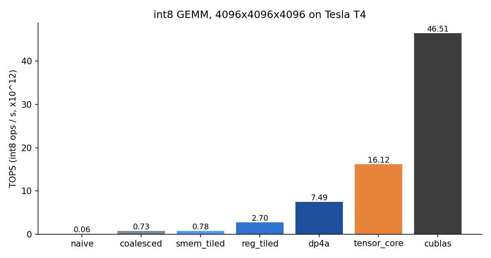
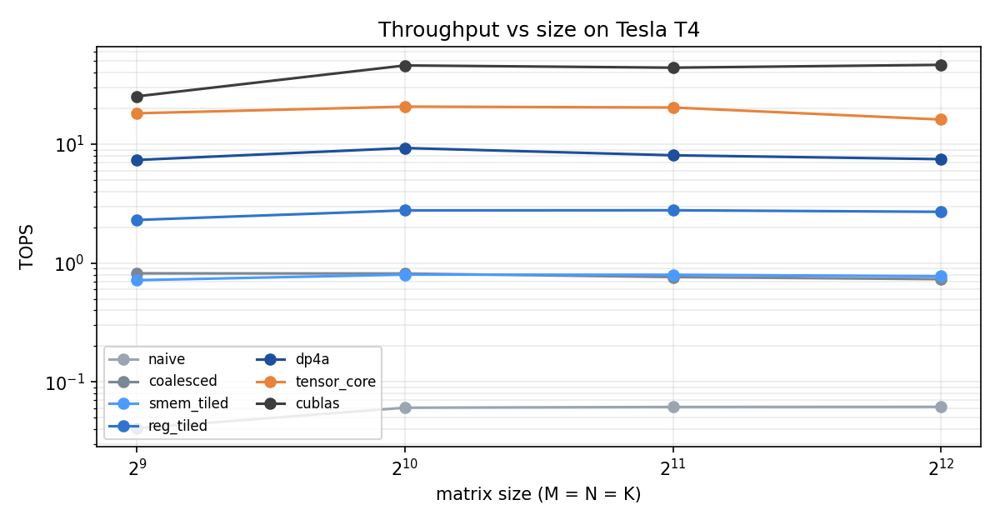
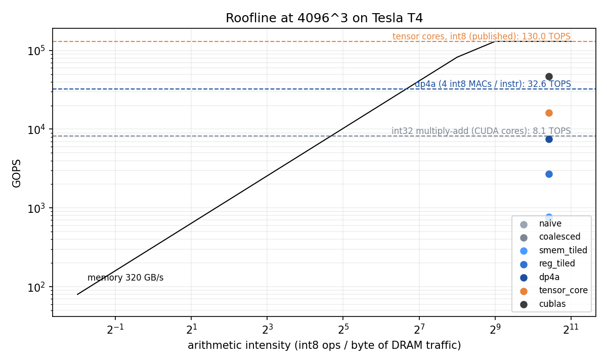

# int8 GEMM in CUDA

Integer matrix-multiply kernels for neural-network inference on NVIDIA GPUs, built up from a naive version to tensor cores.

Quantized neural networks run most of their time in one operation: `C (int32) = A (int8) × B (int8)`. This repo writes that operation seven ways, each fixing the bottleneck of the one before, and measures every step on an NVIDIA Tesla T4.



## Results (Tesla T4, 2048 × 2048 × 2048)

| # | Kernel | What changed | Time (ms) | TOPS | vs. previous |
|---|---|---|---:|---:|---:|
| 1 | `naive` | one thread per output, uncoalesced reads | 278.7 | 0.06 | — |
| 2 | `coalesced` | threads remapped so a warp reads contiguous memory | 22.5 | 0.76 | **12.4×** |
| 3 | `smem_tiled` | 32×32 tiles staged in shared memory | 21.5 | 0.80 | 1.05× |
| 4 | `reg_tiled` | 64×64 tiles, 4×4 outputs per thread in registers | 6.18 | 2.78 | **3.5×** |
| 5 | `dp4a` | four int8 multiply-adds per instruction | 2.13 | 8.07 | **2.9×** |
| 6 | `tensor_core` | WMMA int8 tensor-core matrix ops | 0.84 | 20.36 | **2.5×** |
| 7 | `cublas` | NVIDIA cuBLAS `cublasGemmEx`, for reference | 0.39 | 44.03 | — |

- **330× faster** from the naive kernel to my tensor-core kernel, reaching **46% of cuBLAS**.
- **294× faster** than the Colab CPU (NumPy float32 BLAS, 69 GOPS).
- **Every result is exact.** Each kernel, at every size, is checked against a CPU reference (every element up to 1024³, 4,096 sampled elements above), plus a `--test` suite of awkward shapes like 7×5×3 and 129×67×35. All 28 benchmark runs had 0 wrong elements.

Full data: [`results/results.csv`](results/results.csv) · GPU details: [`results/device.json`](results/device.json)

## What each step taught me

**Coalescing was the biggest single win (12×).** In the naive kernel neighbouring threads read memory K bytes apart, so each warp turned one load into 32 separate memory transactions. Swapping which index comes from `threadIdx.x` changed no math and gave 12×.

**Shared memory alone barely helped (1.05×).** This was the surprising one. On Turing, the L1 cache already captures most of the reuse: Nsight Compute shows the *naive* kernel hitting L1 99.8% of the time. Moving tiles into shared memory by hand only pays off once each loaded value feeds several multiply-adds, which is what register tiling does next (3.5×).

**Packing data matters as much as parallelism.** `dp4a` treats a 32-bit word as four int8 values and does four multiply-adds in one instruction. It needs both operands laid out with K contiguous, so B is transposed once up front.

**Tensor cores are systolic arrays inside the GPU.** Each 16×16×16 WMMA operation runs on dedicated matrix hardware, the same idea as my [4×4 systolic-array accelerator](https://github.com/elvisamaya/systolic-accelerator). The kernel splits a 64×64 block tile across 4 warps (2×2 fragments each) and stages tiles in shared memory in 16-byte halves to keep fragment loads aligned.

**What cuBLAS still does better.** cuBLAS is about 2× faster than my tensor-core kernel. The known techniques I haven't added are double-buffering (loading the next tile while computing the current one), larger warp tiles, and swizzled shared-memory layouts. My kernel also drops from 20.4 to 16.1 TOPS at 4096³, while cuBLAS holds steady. A likely cause is that the working set no longer fits the T4's 4 MB L2 cache and my tile order doesn't reuse L2 well.



### Roofline

GEMM at these sizes is compute-bound: every kernel sits far to the right of the memory ridge. The dashed lines are the T4's compute ceilings: 8.1 TOPS for int32 multiply-add, 32.6 TOPS for `dp4a` (both computed from 40 SMs × 64 lanes × 1.59 GHz), and the published 130 TOPS int8 tensor-core peak. The gap to those ceilings is instruction overhead and latency, not DRAM bandwidth. The T4 also usually runs below its 1.59 GHz boost clock under sustained load because of its 70 W power cap.



## GPU vs CPU vs my accelerator

| Platform | Implementation | GOPS | Notes |
|---|---|---:|---|
| Tesla T4 | cuBLAS | 44,031 | measured, 2048³ |
| Tesla T4 | my tensor-core kernel | 20,363 | measured, 2048³ |
| Tesla T4 | my `dp4a` kernel | 8,068 | measured, 2048³ |
| Colab CPU | NumPy float32 (BLAS) | 69 | measured, 2048³ |
| 4×4 systolic array (sky130) | 100 MHz post-layout | 3.2 | theoretical peak, 16 MACs/cycle |

The accelerator is a 16-MAC design on an open 130 nm process. The T4 has thousands of MAC units on 12 nm, so the gap is expected. The interesting part is that both face the same problem: keeping the multipliers fed with data.

## Run it yourself

**On Colab (no GPU needed locally):** open [`notebooks/run_on_colab.ipynb`](https://colab.research.google.com/github/elvisamaya/int8-gemm-cuda/blob/main/notebooks/run_on_colab.ipynb), set **Runtime → Change runtime type → T4 GPU**, and **Run all**. It builds, tests, benchmarks, plots and downloads `results.zip` in about 5 minutes.

**On a machine with an NVIDIA GPU and the CUDA toolkit:**

```bash
make            # build (ARCH=native; e.g. make ARCH=sm_75 for a T4)
make test       # exact correctness check on edge-case shapes
make bench      # every kernel at 512..4096 -> results/results.csv
make plots      # charts -> results/*.png   (needs matplotlib)
```

CI compiles every kernel for sm_75 on each push. GitHub's runners have no GPU, so correctness and speed are measured on Colab.

## Layout

```
src/
  common.cuh              error checking, problem struct
  gemm_bench.cu           test + benchmark harness (CPU reference, CUDA-event timing)
  kernels/01_naive.cuh … 07_cublas.cuh
scripts/
  plot_results.py         bar chart, scaling chart, roofline
  cpu_baseline.py         NumPy CPU timing
  compare_accelerator.py  GPU vs CPU vs systolic-array table
notebooks/run_on_colab.ipynb
results/                  measured on a Tesla T4 (Colab)
```
